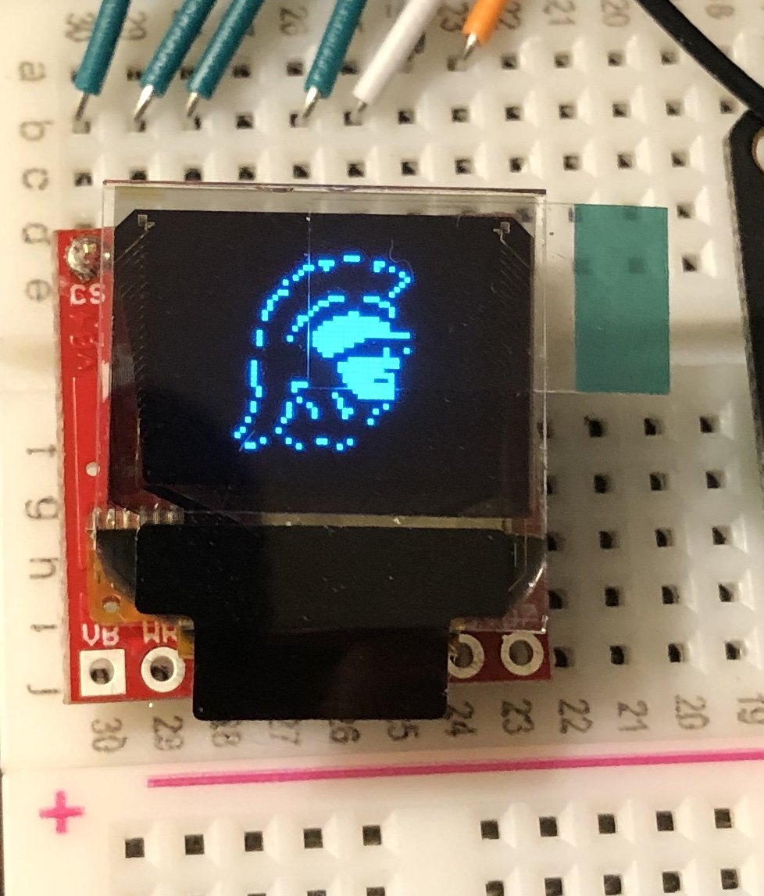
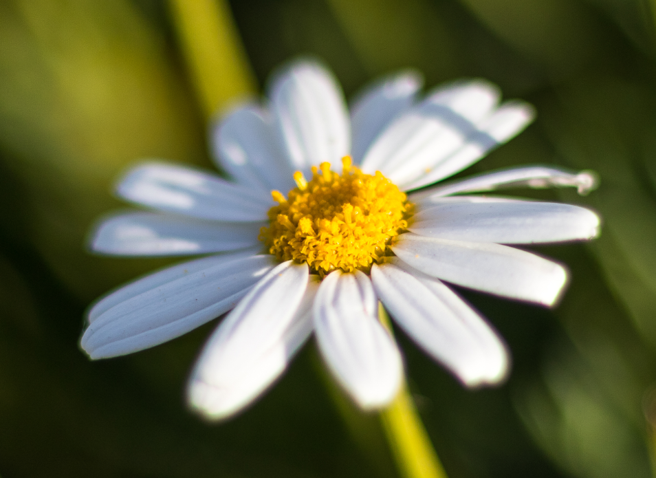
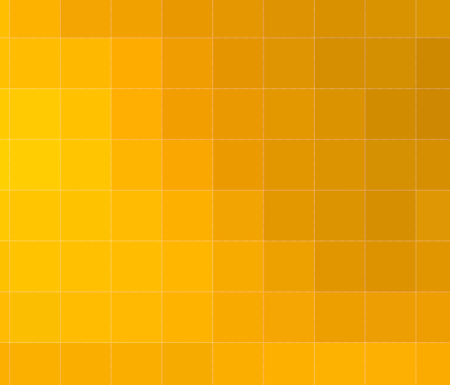
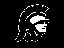
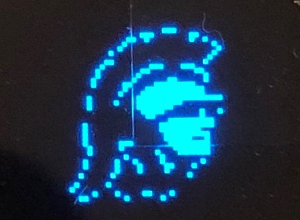
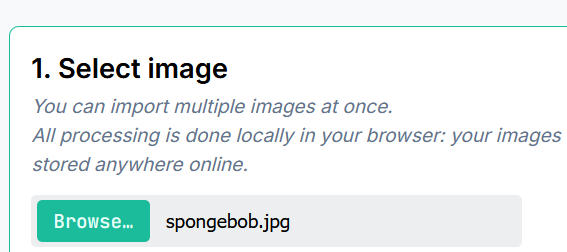
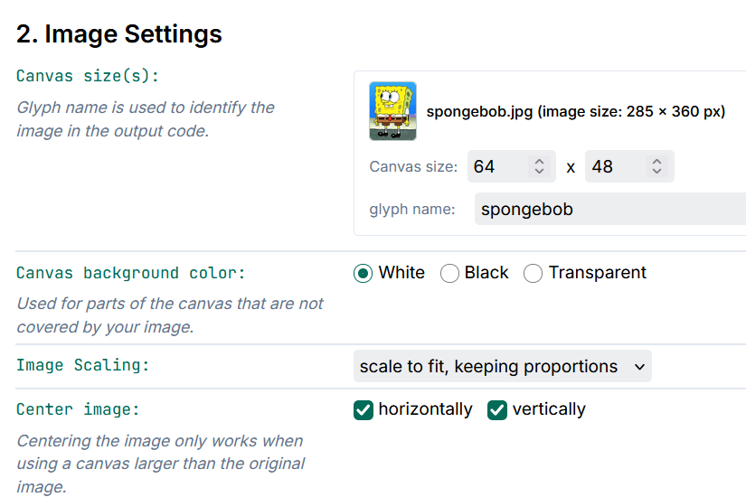
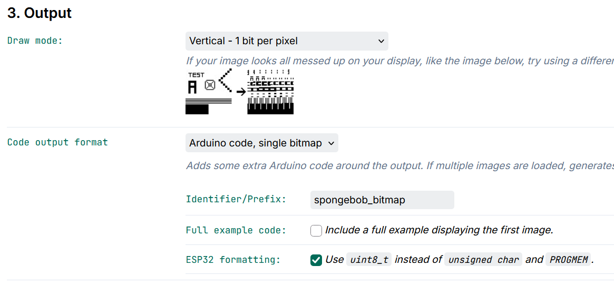
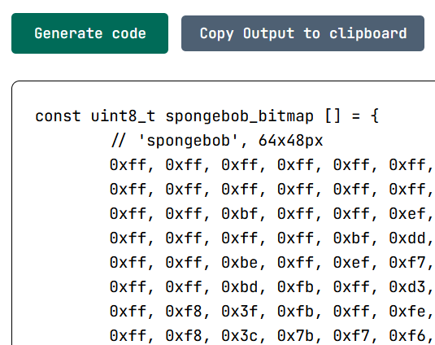

<!-- headingDivider: 2 -->

## OLED Screen Graphics




describe in one slide image vs canvas size


## Screen Parameters

* OLED screen consists of 64 (W) x 48 (H) pixels (3,072 total pixels)
* 3,072 pixels means 3,072 bits (ON or OFF) are needed to display a full image
  * 3,072 bits is 384 bytes (8 bits = 1 byte)
* Each pixel is either ON (HIGH) or OFF (LOW) because there is only one color
* We can display images on the screen in a **bitmap** format

## Pixels

| Original Image                                               | Image Closeup to Show Pixels                                 |
| ------------------------------------------------------------ | ------------------------------------------------------------ |
|  |  |

## Bitmap

* Bitmaps are stored as large arrays of bytes
* In a monochrome image, there is one bit per pixel
  * 64 pixel x 48 pixel images = 3,072 bits = 384 bytes
* Ex:

```c++
const uint8_t heart_bmp[] = { 
  0x00, 0x00, 0x00, 0x00, 
  0x00, 0x00, 0x00, 0x80, 
  0xe0, 0xf0, 0xf8, 0xfc, 
  ... }; 
```


## Creating Bitmaps

* Use a tool to convert image to byte array
* Color Restrictions
  * Each image to be converted should be black and white
  * Color and greyscale can work but not well
* Image Size
  * Use small or actual size images for better conversion to bitmap
## Example Images

| Original Black/White Image                                   | Bitmap on OLED                                               |
| ------------------------------------------------------------ | ------------------------------------------------------------ |
|  |  |

* Color white is what will be displayed on OLED


## Settings

* Note
  * The following settings are specific for the SparkFun Micro OLED
  * Sparkfun library requires that each bitmap be specified as 64x48 pixels or 384 bytes (**canvas size**), even if parts of the image is blank
* Image settings
  - Canvas size: 64x48
  - Glyph name: blank
  - Scaling: Scale fit, keeping proportions
* Output
  - Draw mode: Vertical - 1 bit per pixel
  - Identifier: `<variable name you'll use in your code>`
  - Code output format: Arduino code, single bitmap
  - ESP32 formatting: click checkbox


## Ex: Converting Image with [Image2CPP](https://javl.github.io/image2cpp/)

##



## 



## 



## 



## Storing Byte Array 

* Create a `const uint8_t` array (byte array)

```c++
const uint8_t spongebob_bitmap[] = { 
  0x00, 0x00, 0x00, 0x00, 
  0x00, 0x00, 0x00, 0x80, 
  0xe0, 0xf0, 0xf8, 0xfc, 
  ... }; 
```

* Use library to display bitmap

## Exercise

##### Part 1

* Convert `tac348_full_screen.jpg` to bitmap and load as startup graphic (*image is in the starting folder*)

##### Part 2

* Animate a filled in circle around the screen
* Then have the circle "erase" the background image  


## Wiring Diagram

<span style="font-size:75%">

| Sensor | Photon 2 | Function                                                     |
| ------ | -------- | ------------------------------------------------------------ |
| GND    | GND      | Ground                                                       |
| VCC    | VUSB     | Power **(requires 5v, but will work with 3.7V LiPo battery)** |
| TRIG   | D6       | start output pulse sequence                                  |
| ECHO   | D5       | receive reflection response                                  |


| OLED         | Photon 2 | Function |
| ------------ | -------- | -------- |
| GND          | GND      | Ground   |
| 3V3          | 3V3      | Power    |
| SDA (Blue)   | SDA      | Data     |
| SCL (Yellow) | SCL      | Clock    |

</span>

## Tools for converting images to bitmaps

* Online: [Image2CPP](https://javl.github.io/image2cpp/)
* Windows: [LCD Assistant](http://en.radzio.dxp.pl/bitmap_converter/)
* Mac: [bitmapToC](https://github.com/hoiberg/bitmapToC)

