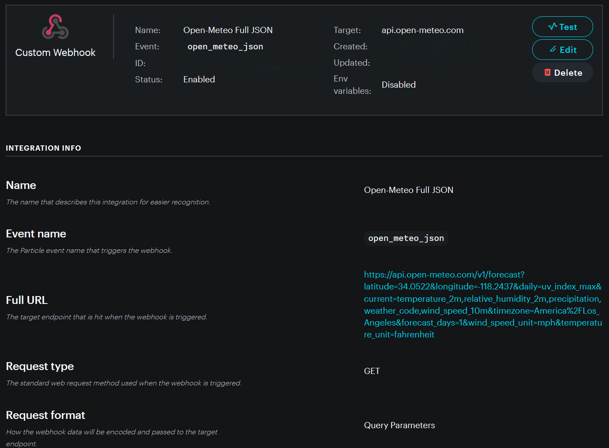

<!-- headingDivider: 2 -->

# Retrieving Data from APIs

## Overview

- APIs provide useful data we can use in our device (e.g. weather and location data)
- Each API will be configured slightly differently but the process to connect is generally similar

##


##


##


##


##


## Steps to Connect Photon 2 and API

0. Read the API documentation
1. Create a webhook in the [Particle Console](https://console.particle.io/integrations)
2. Use `Particle.publish()` to trigger the webhook
3. Use `Particle.subscribe()` to receive its response
4. Create a function handler to process the JSON

* Optional: a [Mustache response template](lecture_retrieving_data_mustache_templates) could send less data to the Photon 2. Our class webhook does not use one.

## Step 0: How to Use the API

- Each API is different, but they will usually have documentation that describes how to connect
- Typically, this will include
  - Endpoint (URL you communicate with)
  - Parameters to include in your request (e.g. latitude and longitude for weather data)
  - How to obtain an API key (if necessary)

## Step 0: Open-Meteo Example

* [Open-Meteo's weather forecast API documentation](https://open-meteo.com/en/docs)
* Endpoint: `https://api.open-meteo.com/v1/forecast`
* Location: `latitude=34.0522` and `longitude=-118.2437` (Los Angeles)
* Current data: temperature, humidity, precipitation, weather code, wind speed
* Daily data: maximum UV index

## Step 0: More Request Settings

* `timezone=America/Los_Angeles`
* `forecast_days=1`
* `wind_speed_unit=mph`
* `temperature_unit=fahrenheit`

[Open the request used by our class webhook](https://api.open-meteo.com/v1/forecast?latitude=34.0522&longitude=-118.2437&daily=uv_index_max&current=temperature_2m%2Crelative_humidity_2m%2Cprecipitation%2Cweather_code%2Cwind_speed_10m&timezone=America%2FLos_Angeles&forecast_days=1&wind_speed_unit=mph&temperature_unit=fahrenheit).

## Step 1: Create Webhook in Particle Console

**Our class webhook settings**

| Setting | Value |
| --- | --- |
| Name | Open-Meteo Full JSON |
| Event name | `open_meteo_json` |
| Request type | `GET` |
| URL | The [Open-Meteo request above](https://api.open-meteo.com/v1/forecast?latitude=34.0522&longitude=-118.2437&daily=uv_index_max&current=temperature_2m%2Crelative_humidity_2m%2Cprecipitation%2Cweather_code%2Cwind_speed_10m&timezone=America%2FLos_Angeles&forecast_days=1&wind_speed_unit=mph&temperature_unit=fahrenheit) |
| Response template | None |

The location is in the webhook URL, so the Photon 2 can publish an empty event value. The webhook sends the full JSON response back to the Photon 2.

##

<a href="lecture_retrieving_data_from_api.assets/open-meteo-webhook-settings.png"></a>

## Part 2: Publish Event to Trigger Webhook

**Photon 2 firmware**

```c++
void loop() {
  // Trigger the Open-Meteo webhook
  Particle.publish("open_meteo_json", "");

  // Wait 10 seconds
  delay(10000);
}
```

## Part 3: Subscribe to the Open-Meteo Response

**Photon 2 firmware**

```c++
void setup() {
  // Subscribe to the integration response event
  Particle.subscribe("hook-response/open_meteo_json",
                     myHandler, MY_DEVICES);
}
```

The webhook response arrives as a Particle event. A long response can arrive in several parts.

## Example: Open-Meteo JSON Response

* This is the `current` section of a real response for Los Angeles, captured November 3, 2026 (Pacific time)
* [View the complete response](lecture_retrieving_data_from_api.assets/open-meteo-los-angeles-response.json)

```json
{
  "current": {
    "time": "2026-11-03T22:45",
    "interval": 900,
    "temperature_2m": 59.9,
    "relative_humidity_2m": 74,
    "precipitation": 0.0,
    "weather_code": 0,
    "wind_speed_10m": 4.8
  }
}
```

## Part 4: Create a Function Handler

* The handler receives the webhook response and reads values from the JSON
* The [JSON parsing lecture](lecture_json_parsing_with_arduinojson) shows the `ArduinoJson` code and the helper for responses that arrive in several parts
* To read this temperature: `doc["current"]["temperature_2m"]`

## Resources

* [Open-Meteo documentation](https://open-meteo.com/en/docs)
* [Particle webhook reference](https://docs.particle.io/reference/cloud-apis/webhooks/)
* [Mustache Tester](https://rickkas7.github.io/mustache/)
* [Mustache Variable Reference](https://docs.particle.io/firmware/best-practices/json/#mustache-variables)
* [JSON Validator and formatter](https://jsonformatter.org/)
