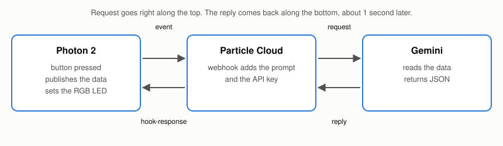
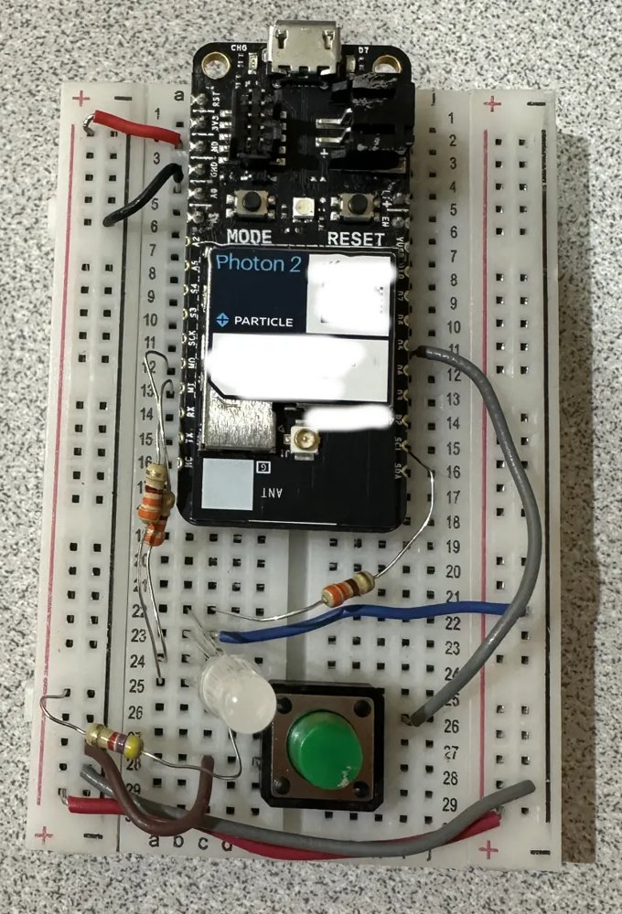
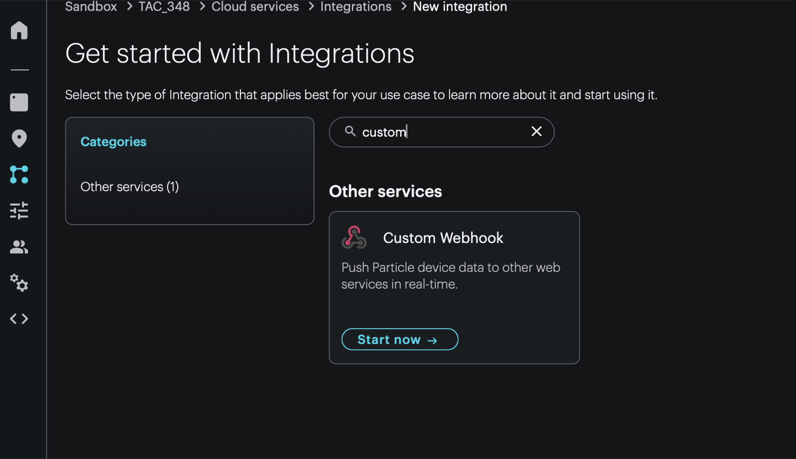
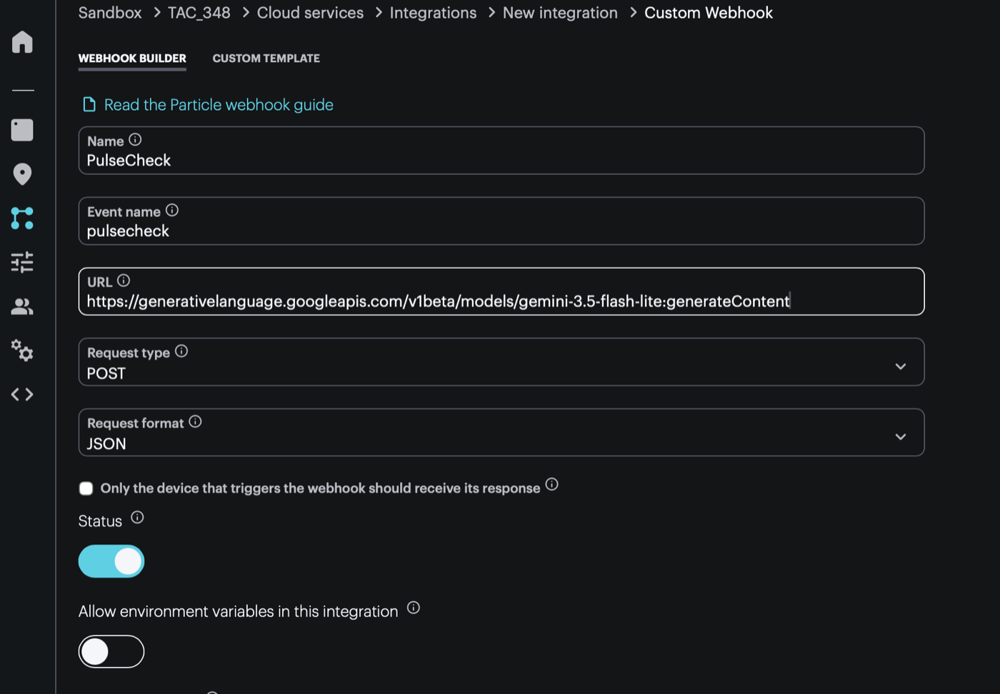
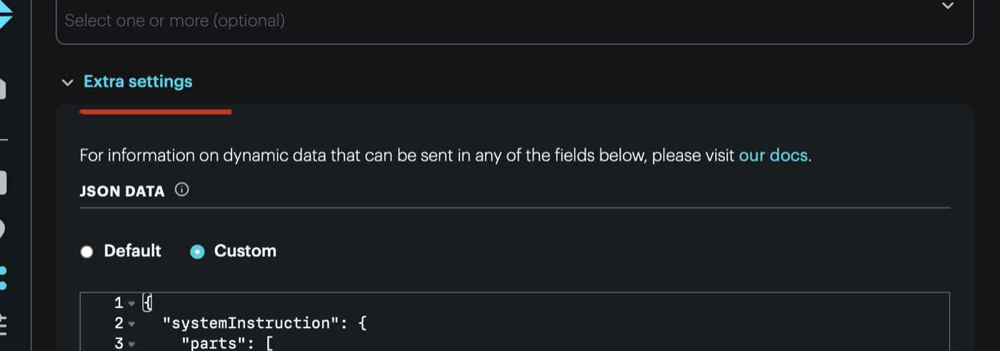
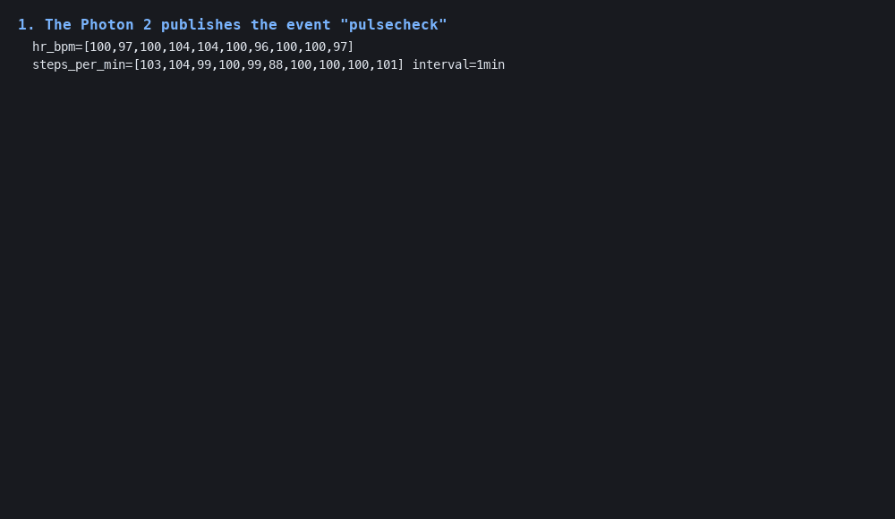
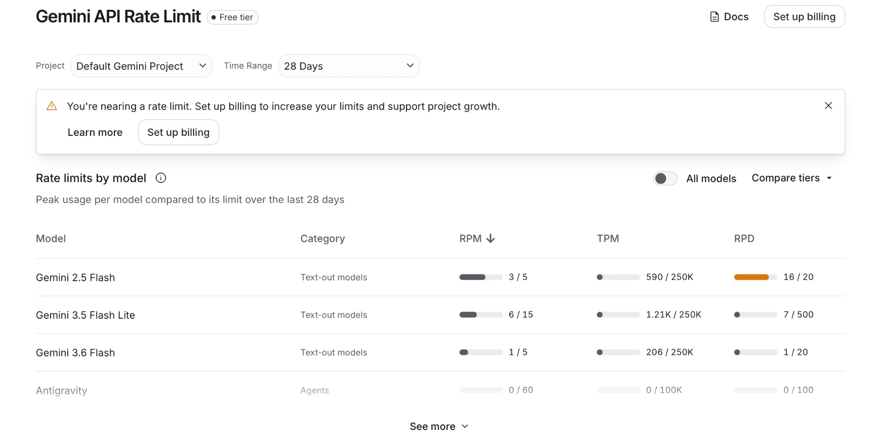

<!-- headingDivider: 2 -->

# PulseCheck - Smart Devices and AI

## What Is PulseCheck?

- Smart watches and rings send your heart rate, steps, and sleep data to AI models for summaries and alerts
- In PulseCheck, the Photon 2 plays the smart watch
  - Press the button to send 10 minutes of real Fitbit heart rate and step data to **Google Gemini**
  - Gemini decides what the wearer is doing and whether anything looks wrong
  - The Photon 2 shows the answer on an RGB LED
- There are two projects on this page
  - **PulseCheck Basic**: the one we build in class. Real Fitbit data, an RGB LED, and a button
    - **Part 1**: five mystery datasets with heart rate and steps
    - **Part 2**: three harder datasets with four more signals: calories, intensity, METs, and sleep
  - **PulseCheck Ring**: optional, for after class. The 11 signals a fitness ring tracks, with no wiring
- For each dataset, you write down what Gemini says. Your instructor goes over the answers at the end of each part
- Note: PulseCheck is not a medical device. Do not send real personal health data to the free tier

## How It Works



- The Photon 2 never talks to Gemini directly. It just publishes an event
- The **webhook** does the AI call, then sends Gemini's answer back as a `hook-response` event
- A reply takes about 1 second

## Why a Webhook?

- The webhook holds your Gemini **API key**, so it never goes on the device
- **Important!** Keep your API key private: never put it in your code, a commit, a screenshot, or a chat
  - Anyone with your key can use up your quota
  - If it leaks, delete it and make a new one
- Review
  - [APIs and Webhooks](/lectures/week05/lecture_api_webhook.html)
  - [Particle + Gemini Integration](/lectures/weekX/lecture_particle_gemini_integration.html) for creating your Gemini API key

# PulseCheck Basic

## Wiring

| Part | Pin | Resistor |
|------|-----|----------|
| RGB LED red | SCL | 330 Ohm |
| RGB LED green | MISO (MI on the board) | 330 Ohm |
| RGB LED blue | MOSI (MO on the board) | 330 Ohm |
| RGB LED common (long leg) | GND | none |
| Button | D5 | 10k Ohm |

- Same wiring as the RGB LED and button exercise
- Note: this is for a common cathode RGB LED. If yours is common anode, the long leg goes to 3V3 instead, and you set `COMMON_ANODE` to `true` at the top of `pulsecheck_setup.h`
  - If the LED is white when it should be off, you have the other kind
- The button reads `LOW` when pressed



- This is what the finished build looks like
- Follow the table for the connections. A photo does not show every leg clearly

## The Data

- Real Fitbit data from a public dataset of 30 people
  - Furberg, R., Brinton, J., Keating, M., & Ortiz, A. (2016). *Crowd-sourced Fitbit datasets 03.12.2016-05.12.2016*. Zenodo. [doi.org/10.5281/zenodo.53894](https://doi.org/10.5281/zenodo.53894) (CC BY 4.0)
- One heart rate and one step reading per minute, for 10 minutes
- Sent as plain text

```
hr_bpm=[72,70,71,72,75,74,75,72,73,75] steps_per_min=[0,0,0,0,0,0,0,0,0,0] interval=1min
```

- Note: no double quotes in the data, or it breaks the webhook's JSON

## Part 1: Five Mystery Datasets

- Each button press sends the next dataset: **A**, **B**, **C**, **D**, **E**, then back to A
- Each one is 10 minutes of a real person: resting, walking, a workout, sleep, or something concerning
  - We don't tell you which is which

| Dataset | Heart rate (bpm) | Steps per minute |
|---------|------------------|------------------|
| A | 96 to 104 | 88 to 104 |
| B | 42 to 43 | 0 |
| C | 63 to 70, then 138 to 144 for the last 4 minutes | 0 |
| D | 70 to 75 | 0 |
| E | 153 to 160 | 166 to 174 |

- Only the numbers are sent to Gemini, never the letter
- The serial monitor prints the letter next to Gemini's answer

```
Sending dataset A
Dataset A | Gemini: state=walking alert=0 msg="Steady walk, avg 100 bpm"
```

- Write down Gemini's `state` and `alert` for each dataset. Your instructor goes over the answers at the end of each part
- Tip: before you press the button, look at the table and make your own guess. The full numbers are in `data/fitbit_windows.csv`

## Gemini's Answer

- The webhook tells Gemini exactly what to send back

```json
{"state": "workout", "alert": false, "msg": "Great pace, avg 156 bpm!"}
```

- `state`: one of `sleep`, `resting`, `walking`, `workout`
- `alert`: true when something looks concerning
- `msg`: a short note for a small watch screen
- This answer arrives wrapped inside Gemini's full reply. Your code unpacks both on the Photon 2
- Check what you get. A state your code does not know should turn the LED magenta
  - Never trust the model's output blindly
- Review
  - [JSON Overview](/lectures/week11/lecture_json_overview.html)
  - [Retrieving Data from APIs using Mustache Templates](/lectures/week11/lecture_retrieving_data_mustache_templates.html): in week 11 a response template trimmed the reply before it reached the Photon 2. Here there is no template: your code deals with Gemini's whole reply

## Starter Code

- Download the [starter code](/resources/pulsecheck/pulsecheck_start.zip) directly
- Unzip it and open the `pulsecheck_start` folder in Particle Workbench
  - `src/pulsecheck.cpp`: your code
  - `src/pulsecheck_setup.h`: the button, the LED, and loading the Fitbit data
  - `src/json_webhook_response_helper.h`: joins a webhook reply that arrives in pieces, the same file as the weather exercises
  - `src/fitbit_data.h`: the Fitbit numbers, compiled into the firmware
  - `data/fitbit_windows.csv`: the same numbers as a spreadsheet, for you to look at
  - `pulsecheck_webhook_body_starter.json`: the JSON body for your webhook, with two blanks
  - `README.md`: step-by-step setup

## Writing Your Prompt

- The prompt is the instructions Gemini reads before it sees the data
  - It goes in the `TODO PROMPT` blank of `pulsecheck_webhook_body_starter.json`
  - Review: [Prompt Engineering for IoT](/lectures/weekX/lecture_particle_gemini_integration.html#prompt-engineering-for-iot)
- Gemini only knows what you tell it. A good prompt answers five questions

| Part | Question it answers | Example |
|------|---------------------|---------|
| Role | Who is Gemini in this job? | You are the analysis engine for a fitness tracker |
| Input | What is the data, and in what units? | Two lists, one value per minute: heart rate in beats per minute and steps per minute |
| Choices | What answers are allowed? | Classify the activity as exactly one of: sleep, resting, walking, workout |
| Rules | How should it decide, and when is it an alert? | Set alert to true only if the heart rate pattern is concerning for that activity |
| Output | What should the reply look like? | Write msg as a friendly note of at most 40 characters |

- Compare

> Tell me what this person is doing.

> You are the analysis engine for a fitness tracker. You receive heart rate in beats per minute and steps per minute, one value per minute. Classify the activity as exactly one of: sleep, resting, walking, workout. ...

- The first one leaves Gemini guessing: what do the numbers mean? what words can it answer with?
- Tips
  - Be specific: say "beats per minute", not "the numbers"
  - Use the same words as your code: if the firmware checks for `"resting"`, the prompt must say `resting`
  - Don't put double quotes inside the prompt, or it breaks the webhook's JSON
- Prompts are written like code: **test, find the mistake, change one thing, test again**
  - If Gemini gets a dataset wrong, ask what it didn't know, and add one sentence that tells it
  - Change one sentence at a time, so you know what fixed it

## Creating the Webhook

- Same steps as [Particle + Gemini Integration](/lectures/weekX/lecture_particle_gemini_integration.html)
- Open `pulsecheck_webhook_body_starter.json`. This is the JSON the webhook sends to Gemini

```json
{
  "systemInstruction": {
    "parts": [
      {
        "text": "TODO PROMPT: write the prompt. Tell Gemini what data it receives, which states to choose from, when to set alert, and how to write msg (at most 40 characters)."
      }
    ]
  },
  "contents": [
    {
      "role": "user",
      "parts": [
        { "text": "{{{PARTICLE_EVENT_VALUE}}}" }
      ]
    }
  ],
  "generationConfig": {
    "temperature": 0.2,
    "thinkingConfig": { "thinkingLevel": "minimal" },
    "responseMimeType": "application/json",
    "responseSchema": {
      "type": "OBJECT",
      "properties": {
        "state": { "type": "STRING", "enum": ["TODO STATES: list the four states the firmware understands"] },
        "alert": { "type": "BOOLEAN" },
        "msg":   { "type": "STRING" }
      },
      "required": ["state", "alert", "msg"]
    }
  }
}
```

- Fill in the two blanks
  - `TODO PROMPT`: your prompt, on one line, with no double quotes inside it
  - `TODO STATES`: `"sleep", "resting", "walking", "workout"`
- Leave the rest as it is
  - `systemInstruction`: the prompt Gemini reads before the data
  - `contents`: the data from your Photon 2
  - `responseSchema`: forces Gemini to answer with exactly `state`, `alert`, and `msg`
- In the [Particle console](https://console.particle.io/), go to **Cloud services > Integrations > Add new integration** and choose **Custom Webhook**



- Stay on the **Webhook Builder** tab and use the following settings
  - **Name**: `PulseCheck`
  - **Event name**: `pulsecheck`
  - **URL**: `https://generativelanguage.googleapis.com/v1beta/models/gemini-3.5-flash-lite:generateContent`
  - **Request type**: `POST`
  - **Request format**: `JSON`
  - "Only the device that triggers the webhook should receive its response": either setting works. Your code listens for both kinds of reply



- Go to **Extra settings**
  - Under **JSON data**, choose **Custom**, delete what is there, and paste your whole body file



  - Under **HTTP headers**, add
    - **Key**: `x-goog-api-key`
    - **Value**: your Gemini API key
  - Leave **Response template** empty

- Click **Enable integration**
- Note: in the body, `{{{PARTICLE_EVENT_VALUE}}}` is where Particle puts the data your Photon 2 published
- Note: with no response template, the Photon 2 receives Gemini's whole reply. Your code finds the answer inside it
- To change your prompt later, open the webhook, click **Edit**, and change it under **Extra settings > JSON data**

## Webhook Troubleshooting

- To see what went wrong, open your webhook in the Particle console and look at its most recent error

| What you see | Cause and fix |
|--------------|---------------|
| LED turns white, then magenta after 20 seconds | No reply reached your code. Check that the webhook is enabled and its event name is `pulsecheck`, that you finished TODO 1 with both subscribe lines, and that the name in them matches the event name |
| LED turns white, then stays off or stays white | The reply arrived but TODO 2 or TODO 3 is not finished. Look at the serial monitor: an empty `state=` means the JSON was not unpacked |
| LED turns magenta right away | The request was rejected. Read the error on the webhook's page |
| `Header name must be a valid HTTP token` | There is an HTTP header row with an empty name. The name is `x-goog-api-key`, the value is your key, and there are no blank rows |
| Error 400 or `API_KEY_INVALID` | The API key is wrong or missing |
| Error 400 "Unknown name" | Something other than the body file is in **JSON data**. Only the body goes there |
| Error 404 | The model in the URL was retired. Use the current Flash-Lite model |
| Error 429 | You used up your free quota. Wait a minute, or change the model in the URL for the rest of the day |

- Note: after you change the webhook, press the button again to test it. You don't need to flash again

## Reading Gemini's Reply

- This is the same pattern as the weather exercises
  - Review: [Retrieving Data from an API](/lectures/week11/lecture_retrieving_data_from_api.html) and [JSON Parsing with ArduinoJson](/lectures/week11/lecture_json_parsing_with_arduinojson.html)
- **Step 1**: subscribe to the webhook's reply in `setup()`

```c++
Particle.subscribe("hook-response/pulsecheck", onWebhookReply, MY_DEVICES);
Particle.subscribe(System.deviceID() + "/hook-response/pulsecheck", onWebhookReply, MY_DEVICES);
```

- The first line is the same as the weather exercises
- The second line is for webhooks that put the device ID in front of the reply's name, for example `0a10aced.../hook-response/pulsecheck/0`
  - `Particle.subscribe()` matches the start of a name, so the first line alone would miss those replies
  - To see which name your webhook uses, watch the **Events** tab in the Particle Console when you press the button

- **Step 2**: the event handler receives the reply in `data`

```c++
void onWebhookReply(const char* event, const char* data) {
    // A long reply arrives in pieces. This returns "" until all of it is here.
    String fullJson = json_webhook_response_helper(event, data);
    if (fullJson == "") return;
    if (!geminiGotReply()) return;               // stops the timeout; ignores late replies

    // your code: unpack the reply, then set the LED
}
```

- **Step 3**: look at what arrived. `fullJson` is Gemini's whole reply, not just your three values

```json
{
  "candidates": [
    {
      "content": {
        "parts": [
          {
            "text": "{\"state\": \"workout\", \"alert\": false, \"msg\": \"Great pace!\"}",
            "thoughtSignature": "EnsKeQFpFH0T..."
          }
        ],
        "role": "model"
      },
      "finishReason": "STOP"
    }
  ],
  "usageMetadata": { "promptTokenCount": 412, "candidatesTokenCount": 21 },
  "modelVersion": "gemini-3.5-flash-lite"
}
```

- One real request and reply, for dataset A



- Your answer is the `text`, four levels down: `candidates`, the first item, `content`, `parts`, the first item, `text`
- Ignore the rest: `thoughtSignature` is a long code Gemini adds for its own use, and `usageMetadata` counts tokens
- That text is itself JSON, stored as a string. That is why its quotes have a `\` in front
- So you unpack **twice**
- **Step 4**: unpack the reply with `ArduinoJson` and take out the text
  - Create a `JsonDocument` and `deserializeJson()` `fullJson` into it
  - Check the `DeserializationError` it returns before you read anything
  - Follow the path down to the text. You wrote this same line in the week 12 smart watch exercise, where the text was a sentence

```c++
String answerText = doc["candidates"][0]["content"]["parts"][0]["text"].as<String>();
```

- **Step 5**: unpack the text the same way, into a second `JsonDocument`, and read your three values from it

```c++
state = answer["state"].as<String>();
```

- A reply this size often arrives in two or more pieces. `json_webhook_response_helper()` joins them, which is why you unpack `fullJson` and not `data`
- Note: `geminiGotReply()` comes from the `GeminiWebhook` library. It tells the library that the answer arrived, so the 20 second timeout stops

## Part 1: Your Job

- `pulsecheck_setup.h` and the `GeminiWebhook` library handle the button, the Fitbit data, sending, and timeouts
  - You don't need to change them for Part 1
- Write your prompt using the five parts above, and create the webhook
- Install two libraries in Workbench with **Particle: Install Library**. The starter does not come with them
  - `ArduinoJson`: unpacks JSON
  - `GeminiWebhook`: sending, waiting, and timeouts. You can install it in any project
- In `pulsecheck.cpp`:
  - **TODO 1**: subscribe to the webhook's reply in `setup()`
  - **TODO 2**: unpack the JSON into `state`, `alert`, and `msg` in `onWebhookReply()`
  - **TODO 3**: show the answer on the RGB LED with `changeLedColor(r, g, b)` and `showAlert()`
  - **TODO 4** (optional): write your own `safetyRule()`
- Run datasets A to E and write down Gemini's answer for each one

## When Gemini Gets It Wrong

- With our first prompt, Gemini missed the most important window: heart rate jumps while sitting still
  - Gemini: "Great workout!" and no alert
  - It looked at heart rate and ignored the steps
- It also reported the wrong average heart rate
  - Language models are not reliable at math over a long list of numbers

## Fixing the Prompt

- Adding one sentence to the prompt fixed the label

> Decide the state from the steps first: if steps stay near zero, the state is resting or sleep, never walking or workout, even when heart rate is high.

- A better prompt makes the right answer more likely
- But it is not a guarantee

## Safety Rule

- The guarantee comes from plain code on the Photon 2: `safetyRule()`
- Alert when **both** are true
  - the heart rate of the last quarter of the window is 30+ bpm above the first half
  - steps stay under 10 per minute
- The alert turns on even if Gemini says no, or the webhook fails
- `defaultSafetyRule()` in `pulsecheck_setup.h` is a ready-made version
- Let the model interpret the data. Keep safety checks in code you can test

## Part 2: More Signals

- Heart rate and steps alone can't tell everything apart
  - Lying awake and sleeping look the same
  - Cycling or rowing has a high heart rate but almost no steps, so it looks like a spike at rest
- Real watches send more. Part 2 adds four signals from the same Fitbit dataset, for six in total

| Signal | What it means | Example |
|--------|---------------|---------|
| <code style="white-space:nowrap">calories_per_min</code> | Calories burned each minute. About 1 at rest, 10 or more in hard exercise | <code style="white-space:nowrap">[12.4,12.4,10.5,...]</code> |
| <code style="white-space:nowrap">intensity</code> | Fitbit's activity level: 0 sedentary, 1 light, 2 moderate, 3 very active | <code style="white-space:nowrap">[3,3,3,...]</code> |
| <code style="white-space:nowrap">mets</code> | Energy use compared to rest. 1.0 = sitting still, 3+ = exercise, even with no steps | <code style="white-space:nowrap">[9.0,9.0,7.6,...]</code> |
| <code style="white-space:nowrap">sleep</code> | Fitbit's sleep tracking for each minute: awake, asleep, or restless | <code style="white-space:nowrap">[asleep,asleep,...]</code> |

- Note: Fitbit works out calories, intensity, and METs from its motion sensor, so they tend to move together. Sleep comes from its sleep tracking
- Three new datasets: **F**, **G**, **H**
  - All three have zero steps the whole time
  - All three are real, unedited Fitbit data

| Dataset | Heart rate (bpm) | Steps | Calories per minute | Intensity | METs | Sleep |
|---------|------------------|-------|---------------------|-----------|------|-------|
| F | 60 to 63, then 96 to 97 for the last 3 minutes | 0 | 0.9 to 1.1 | 0 | 1.0 to 1.2 | asleep |
| G | 132 to 191 | 0 | 10.5 to 19.3 | 3 | 7.6 to 14.0 | awake |
| H | 65 to 74, then 90 to 100 for the last 4 minutes | 0 | 1.0 to 1.3 | 0 | 1.0 to 1.2 | awake |

```
hr_bpm=[62,62,...] steps_per_min=[0,0,...] calories_per_min=[0.9,0.9,...] intensity=[0,0,...] mets=[1.0,1.0,...] sleep=[asleep,asleep,...] interval=1min
```

## Part 2: Your Job

- Set `PART` to `2` at the top of `pulsecheck_setup.h` and flash
- Update your prompt so Gemini knows what the four new signals mean
  - Without it, Gemini has to guess what the new numbers are
- The safety rule is ready-made: `defaultSafetyRule()` switches to METs in Part 2
  - Part 1: still = steps under 10 per minute
  - Part 2: still = METs at 1.5 or below
  - Steps miss exercise like cycling. METs do not
- Run datasets F to H and write down Gemini's answer for each one

## Free Tier Limits



| Model | Requests per minute | Requests per day |
|-------|---------------------|------------------|
| `gemini-3.5-flash-lite` | 15 | 500 |
| `gemini-3.6-flash` | 5 | 20 |
| `gemini-2.5-flash` | 5 | 20 |

- Use `gemini-3.5-flash-lite`: one press a minute is about 100 requests per class
- Limits are per Google project, so use a key from your own Google account
- The daily limit resets at midnight Pacific time
- Ran out (error 429)? Switch the webhook to another model. Each model has its own quota

# PulseCheck Ring

## What Is PulseCheck Ring?

- An optional second project, for after you finish Basic
- The same pipeline, with the **11 signals** a fitness ring tracks instead of heart rate and steps
- **No wiring**: it uses the Photon 2's own RGB LED and its MODE button
- The data is made up on the Photon 2, in five scenarios numbered 1 to 5
- You do the same work as in Basic: write the prompt, create the webhook, subscribe to the reply, unpack it, and set the LED

| | Basic | Ring |
|---|---|---|
| Data | Real Fitbit data, 8 datasets | Made-up data, 5 scenarios |
| Signals | 2 in Part 1, 6 in Part 2 | 11 |
| LED and button | On a breadboard | The Photon 2's own LED and MODE button |
| Sending | One button press at a time | Every 30 seconds, or on a tap of MODE |
| Event name | `pulsecheck` | `pulsering` |
| Libraries | `ArduinoJson`, `GeminiWebhook` | The same |

## Ring: The Data

- One reading per minute for 10 minutes, for each signal

| Signal | Name in the data | Unit |
|--------|------------------|------|
| Heart rate | `hr_bpm` | beats per minute |
| Steps | `steps_per_min` | steps per minute |
| Heart rate variability | `hrv_ms` | milliseconds. Higher usually means more relaxed |
| Skin temperature | `skin_temp_c` | degrees C |
| Blood oxygen | `spo2_pct` | percent. Normal is 95 or more |
| Breathing rate | `breaths_per_min` | breaths per minute |
| Movement intensity | `motion_g` | g. Near 0 when still |
| Calories burned | `kcal_per_min` | kcal per minute |
| Temperature change from baseline | `temp_delta_c` | degrees C |
| Stress score | `stress` | 0 to 100 |
| Sleep stage | `sleep_stage` | `awake`, `light`, `deep`, or `rem` |

- The five scenarios are resting, walking, a workout, sleep, and something a ring should worry about
- The number does not tell you which is which. Only the numbers in the data are sent to Gemini

## Ring: Starter Code

- Download the [Ring starter code](/resources/pulsecheck/pulsering_start.zip) directly
- Unzip it and open the `pulsering_start` folder in Particle Workbench
  - `src/pulsering.cpp`: your code
  - `src/pulsering_setup.h`: the MODE button, the LED, and the ring data
  - `src/json_webhook_response_helper.h`: the same file as in Basic
  - `pulsering_webhook_body_starter.json`: the JSON body for your webhook, with two blanks
  - `README.md`: step-by-step setup

## Ring: Your Job

- Create a **second webhook**, the same way as in Basic, with two changes
  - **Event name**: `pulsering`
  - **JSON data**: your filled-in `pulsering_webhook_body_starter.json`
- Write a new prompt. It has to explain all 11 signals and their units
- Install the `ArduinoJson` and `GeminiWebhook` libraries in this project too
- In `pulsering.cpp`, the TODOs are the same as in Basic
  - **TODO 1**: subscribe to the reply, with `pulsering` in the event name
  - **TODO 2**: unpack Gemini's reply into `state`, `alert`, and `msg`
  - **TODO 3**: show the answer on the LED
  - **TODO 4** (optional): write your own `safetyRule()`, for example an alert when blood oxygen drops below 92
- Flash it. The Photon 2 sends the next scenario by itself every 30 seconds. Tap MODE to send one right away
- The serial monitor prints the scenario number next to Gemini's answer

```
Sending scenario 1
Scenario 1 | Gemini: state=walking alert=0 msg="Steady walk, HRV 35 ms"
```

- Write down Gemini's `state` and `alert` for scenarios 1 to 5, then check them in the Answers section
- Important! Sending every 30 seconds uses 120 requests an hour. Unplug the Photon 2 when you are done, or set `AUTO_SEND_MS` to `0` in `pulsering_setup.h`

# Answers

## Answers for Basic and Ring

- Your instructor gives you the password at the end of each part
- It unlocks the answers for both projects
- The answers are stored scrambled. They appear only with the right password

<!-- answers:start (made by tools/lock_answers.mjs; do not edit by hand) -->
<div id="pc-answers" data-salt="MEfFn/iIKxohIJyignzisg==" data-iv="N8fdIenSy5FDKiqv" data-text="c8LffLGDaFjU1Sn3nAagdaadxigpq3gbSNse6ZbUvUDwYjCfP9dPWLc8mN/f4dXgDLSDcILC1xsy0JD4p70resvOylTOSYMcOe6JJp3aD9HJtZQ4RXXwTtjyLzj+m+Zmm/EtNFGoAi+M0RlP6/t5h3oNrAMcfx8JBF/2l7ZVc6hVb7jsd3iuGr48Kepw8cnXgvNMgCI2XEePMUrG1zLpgoteKDOQivk+WKtBX2iy8S6t1OPgRqhUR/0BkJZqWZv3gHzJVse+O2Ul/OYJGWL6J6PTOK5rQC5BNR8c3vvymvE6UuKE7furFAhp2FapIGuRsOHRZ3yer7tmNCiklqXckBNMG/7+RP+7MoN0G1o4ct/rodaIiwy9/mgNQ7z1bx8qABRMQhf+H0/DrzJyjcgouZ1el2hvfA/SGM8Kdm5ruIn5oHFvjAdCL6VFZeD09Y1YFex7/h3c44LDE+PCgYEu4Ad25xQ9zhk0t/4iBGlFu9EbSbek9J74G+aEeWrxEvDLYnxb9hVJqYSGC/E/ROKPLYWnjN2kuwpeHi8dACrtefmq/Nko22r6fQODa/n5QRtwfRNZUdURdXZYhL8CUsq9ALZdWpvdDXtHVLFgFoCseSFudSdmlHJ4rFZzRyxjvTVkPjamELtBzrN92+Z+RH3jyjJt/ntptOtwF2d5wIABLeRd8nVK7cO91yrxlpwIqdnch8qYDHMQ9pN+NSmQm6Fwut4zLRnaeuyvGR6yIaTXb4NhpARtpjCmA0ilUENmbPcDoI48JUCufSAqHLDYOCuMXP+2mykjtz0n+ndLLb194GxlBXUSDWWmgbShQlAA3OrZBePYPcUsmn7U1GjAn3wioYmNg6muyetCxg9usXAAAodxLxwTJEUYvoJCFCjvOiIYYEthwjTY+7tkDchJs6e9YgnQXGp3IVvELpvWKr1RxxhnfvK7c134uhzclRgreOgX+mpp8q0V/GcnqiwKNOODfXnAyuqeBr086t78+cZsahlzJce6nuvzcA89F/0iHc0oXcwCyqITlaIlpwi9KARGGP/+vBpnLG5H6rpKFso+heQghZVvp/eD4DvVaS8VM0m02M3saxn/rwC5DRmWzxA+p5HzBTT/JI72Zkm49EuS8FELCVY/v4jjFZ1vBGwxHRvpkw7MiY+89dpS3pMpHdHye7k6ocfIVo1zACMGnZGhJX0q/6uo8J9Z26jOTQRYfW3XteMBCLU/uIaXNMyQqwiQXV0wa01+fL9MUqClkkC4tXOYmca6W5bSabHmCDOkO4fRW5t2mj0k4dJLvmgbtUWJ6h9CzRIAWUNfu2I9GXieQYJKfg+XllBbQGeaf9lLqmVzUn+z/0krgap7iD9V4xIPsIHjKp7qxo0Q8i/oHA/Ke7CY4/xoFTXBjgxbZEsBqXlEIvCmv2+hv7hXKg5+vHffpcbLOHckklMVTPpB7M3TEGJ5UTwszfpKCOCMIrwtDZxD14St+px/QYWlBbU40ynx86iq/i2hkdG7z4UwyDgwrn+USZEKALBTpZhe4I5BAf98Do3HwbonA04PYcuILV6JESrwazaFhpDWhoMesXgU+xqV2OyE3gBTrhuBFATRc1LuUZUwN5kzLniQtzSt+3q19aVnfhFr0gTNWV1YeaUx8akt15bIIYtJXLMHOH3iKp2QkCKb8IAxa+gBiBr3UBWEbDCTx/gmYoFw6qnBfRsA3YNFKpbIQsGp+VaQa8INhgQm/alJEOmmftFGixfFTrDpMIAja06kDuEI1ADLcIIVi9/Ocv70bpT7QfSLWPuRsdpohDUDbdTGpeVVrWrDJ2iNn8aacIJuzdWcU/le1Q+Lnaw2ZCC7TFNCV3P12nBs8z1tYL0RKyU9Uu9xbU1vAqA5N2WTmxKRvQdtZ2KqxiOHRV5FqdHfR3g3r6DiAQf7NWVIth1zzfP4N1CcIGmDXS5fBRqggVTjH0DLq12r/9PX424psS3xZTomuXoGo8/96/F5PZ4eXCW1ZoL8/Z2mGRruhMczZcFELWm8Eg2iOZ8POpUXwC7sRrvhnNH3veX1HMvNY2MaKyZilJK79nejlCNEikK6eMUCVhWzjn0yAmklf4tOXlfn9k9rs6vYzzIzqyOC/ezWmD7DmLduK8AkU7d7eO2YUFKZI4QfO8o00XUMp/IAhlv1icmME40ledTwHzOuOPi+Shgjpu7jVTIOTyLanBhgJ8IaP3j5gFTX8NJvZYSL8yeQhKJG7rg2h/Ma58n5uMtu7xwAOiMFXbaz+ES42bxN5MtAV2N16mQQMWFrm8pZqFJmR4H8MpJumu/5yHY1a44iSY/dsAGqoxPxmRBujtQiB4etB9lbfBraedUDG5XcDeURvdjDx4bDXGCmr4uB6ZQlXy8VE1rtJMefDiRK4W9r6RWjMrk9v4Z0cpkc/w6J7isVYNlQtwh/WVS4CVShLHJetcxoA8INXZUh8bAmHXLH8HWxgXg86G4ezELtxP8s7EpyhmVKDJCdwWP7VtqU6tdf2QX06ROobdfIQfviWRCnbyYgnRSpHMtphCAuQYAsEQXDCCJV8ov4gWRBcCDNjlrAe8PY9e4j2WADvHclR+B8KK+uZvVBnM5p3syidXlhyswSX9Ap0CJg9waguf0Hdzc6xfDLBuj4V17P1rnIYNXTJazdYo5NaJLnkJE1/AUmY8wsevCfn61Q88KPDMdQ7Z9p0DbptBFIj2HLnQDqAj7mmk8FWcEfd6JYYhWS94Q7A2Ej1GK7jgygbzUBzN6JG5NWq8+jr17z+XimZdTCWUKnEAsJX4LvfvvXzZzru2RPidE4R7BuK+cO4s0wPTaJh6juO6ks7E5PJT1aZYQKmC4LkVHLAfKN45Cy1iGyW+mJgAYoMnTBXUk2+z6A2mxuvMgaRYjIiKGAssRuwB0rSAGyIgOYSyUqfWUM/rIRGjizu4Xje1JMMqWCOX42vvk3TtmRBfgSIbfWGJpNZuOUaf6Wsc6mNuTGD/lcCRP4ZlrLuUIsxLc1i/g2OZ30HKyw2/lTFdM8Rnjk6cEbZwC9fkV1AYD49zBdNiBhrv4XUCSCrtTbhKvx6systHw5U6UA+Lr0fkPouPE=">
  <label for="pc-answers-password">Password</label>
  <input type="password" id="pc-answers-password" autocomplete="off" style="width:16em; display:inline-block;" />
  <button type="button" id="pc-answers-button">Show answers</button>
  <p id="pc-answers-message" role="status"></p>
  <div id="pc-answers-content"></div>
</div>
<!-- answers:end -->

<script>
(function () {
  var box = document.getElementById('pc-answers');
  if (!box) return;
  var input = document.getElementById('pc-answers-password');
  var message = document.getElementById('pc-answers-message');
  function bytes(b64) {
    var s = atob(b64), out = new Uint8Array(s.length);
    for (var i = 0; i < s.length; i++) out[i] = s.charCodeAt(i);
    return out;
  }
  function unlock() {
    if (!window.crypto || !crypto.subtle) { message.textContent = 'This browser cannot unlock the answers.'; return; }
    message.textContent = 'Checking...';
    crypto.subtle.importKey('raw', new TextEncoder().encode(input.value), 'PBKDF2', false, ['deriveKey'])
      .then(function (base) {
        return crypto.subtle.deriveKey(
          { name: 'PBKDF2', salt: bytes(box.dataset.salt), iterations: 200000, hash: 'SHA-256' },
          base, { name: 'AES-GCM', length: 256 }, false, ['decrypt']);
      })
      .then(function (key) {
        return crypto.subtle.decrypt({ name: 'AES-GCM', iv: bytes(box.dataset.iv) }, key, bytes(box.dataset.text));
      })
      .then(function (plain) {
        document.getElementById('pc-answers-content').innerHTML = new TextDecoder().decode(plain);
        message.textContent = '';
        input.value = '';
      })
      .catch(function () { message.textContent = 'That password is not right.'; });
  }
  document.getElementById('pc-answers-button').addEventListener('click', unlock);
  input.addEventListener('keydown', function (e) { if (e.key === 'Enter') unlock(); });
})();
</script>

# Your Own Project

## Using It in Your Own Project

- The `GeminiWebhook` library is not tied to PulseCheck. Install it in any project that sends text to an AI model through a webhook
- It handles what is the same every time
  - sending no more often than your free quota allows
  - knowing whether you are still waiting for a reply
  - giving up if no reply comes (timeout)
  - telling you when the webhook reports an error
- You write what is different every time: what to send, and how to unpack the reply

| Function | What it does |
|----------|--------------|
| `geminiSetup("my_event")` | Call once in `setup()`. The name must match your webhook's event name |
| `geminiSend(text)` | Sends the text to your webhook. Returns `false` if it is too soon or a reply is pending |
| `geminiReady()` | `true` when `geminiSend()` would send |
| `geminiWaiting()` | `true` while a request is out and no reply has arrived |
| `geminiGotReply()` | Call at the start of your reply handler. Stops the timeout. Returns `false` for a late reply |
| `geminiLoop()` | Call every time through `loop()`. Reports a timeout |
| `onGeminiError(String why)` | **You** define this. It is called when a request fails |

- A complete example

```c++
#include "Particle.h"

#define ARDUINOJSON_ENABLE_ARDUINO_STRING 1
#include <ArduinoJson.h>

#include "json_webhook_response_helper.h"
#include "GeminiWebhook.h"

SYSTEM_MODE(AUTOMATIC);
SYSTEM_THREAD(ENABLED);

// The webhook's reply, for example {"answer": "Open a window"}
void myHandler(const char* event, const char* data) {
    String fullJson = json_webhook_response_helper(event, data);
    if (fullJson == "") return;
    if (!geminiGotReply()) return;

    // Gemini's whole reply; the answer is the text deep inside it
    JsonDocument doc;
    if (deserializeJson(doc, fullJson)) return;
    String answerText = doc["candidates"][0]["content"]["parts"][0]["text"].as<String>();

    // that text is JSON too
    JsonDocument answer;
    if (deserializeJson(answer, answerText)) return;
    Serial.println(answer["answer"].as<String>());
}

// Called when a request fails
void onGeminiError(String why) {
    Serial.println("No answer: " + why);
}

void setup() {
    Serial.begin(9600);
    geminiSetup("my_event");
    Particle.subscribe("hook-response/my_event", myHandler, MY_DEVICES);
    Particle.subscribe(System.deviceID() + "/hook-response/my_event", myHandler, MY_DEVICES);
}

void loop() {
    geminiLoop();
    if (geminiReady()) {
        geminiSend("temperature=72F humidity=40%");   // sends again every 10 s
    }
}
```

- To use it
  - Install the `GeminiWebhook` and `ArduinoJson` libraries (**Particle: Install Library**)
  - Copy `json_webhook_response_helper.h` into your project's `src` folder
  - Create a webhook the same way as PulseCheck, with your own event name, prompt, and `responseSchema`
- To change the limits, pass them to `geminiSetup()` in milliseconds: `geminiSetup("my_event", 5000, 30000)` is one request every 5 seconds and a 30 second timeout
