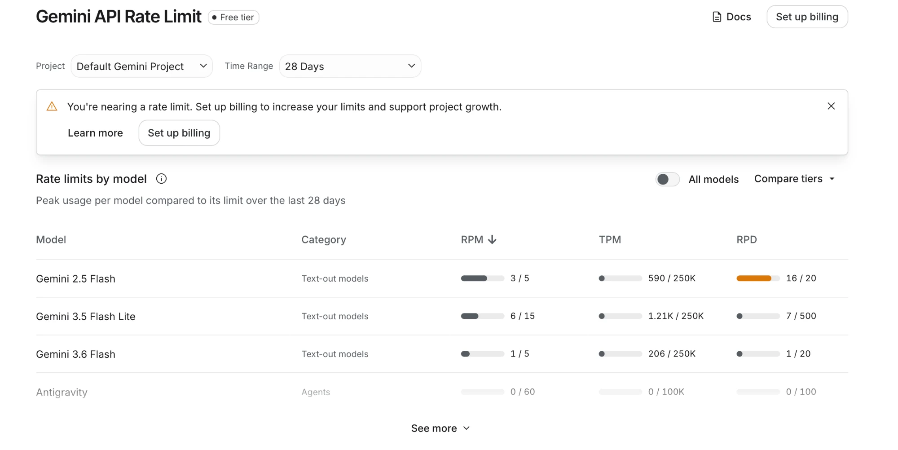

<!-- headingDivider: 2 -->

# PulseCheck - Smart Devices and AI

## What Is PulseCheck?

- Smart watches and rings send your heart rate, steps, and sleep data to AI models for summaries and alerts
- In PulseCheck, the Photon 2 plays the smart watch
  - Press the button to send 10 minutes of real Fitbit heart rate and step data to **Google Gemini**
  - Gemini decides what the wearer is doing and whether anything looks wrong
  - The Photon 2 shows the answer on an RGB LED
- Two parts
  - **Part 1**: five mystery datasets with heart rate and steps
  - **Part 2**: three harder datasets with two more signals, METs and sleep
- For each dataset, you write down what Gemini says, then check it against the answer key
- Handout: [PulseCheck Student Handout](lecture_pulsecheck_handout.html)

## How It Works

```
Photon 2                      Particle Cloud                  Gemini
--------                      --------------                  ------
button pressed
Particle.publish(event)  -->  webhook adds the prompt   -->   reads the data
                              and the API key                 returns JSON
onWebhookReply()         <--  hook-response event       <--   {"state", "alert", "msg"}
set the RGB LED
```

- The Photon 2 never talks to Gemini directly. It just publishes an event
- The **webhook** does the AI call, then sends Gemini's answer back as a `hook-response` event
- A reply takes about 1 second

## Why a Webhook?

- The webhook holds your Gemini **API key**, so it never goes on the device
- **Important!** Keep your API key private: never put it in your code, a commit, a screenshot, or a chat
  - Anyone with your key can use up your quota
  - If it leaks, delete it and make a new one
- Review
  - [APIs and Webhooks](/lectures/week05/lecture_api_webhook.html)
  - [Particle + Gemini Integration](/lectures/weekX/lecture_particle_gemini_integration.html) for creating your Gemini API key

## Wiring

| Part | Pin | Resistor |
|------|-----|----------|
| RGB LED red | SCL | 330 Ohm |
| RGB LED green | MISO (MI on the board) | 330 Ohm |
| RGB LED blue | MOSI (MO on the board) | 330 Ohm |
| RGB LED common (long leg) | 3V3 | none |
| Button | D5 | 10k Ohm |

- Same wiring as the RGB LED and button exercise
- The button reads `LOW` when pressed

## The Data

- Real Fitbit data from a public dataset of 30 people
  - Furberg, R., Brinton, J., Keating, M., & Ortiz, A. (2016). *Crowd-sourced Fitbit datasets 03.12.2016-05.12.2016*. Zenodo. [doi.org/10.5281/zenodo.53894](https://doi.org/10.5281/zenodo.53894) (CC BY 4.0)
- One heart rate and one step reading per minute, for 10 minutes
- Sent as plain text

```
hr_bpm=[72,70,71,72,75,74,75,72,73,75] steps_per_min=[0,0,0,0,0,0,0,0,0,0] interval=1min
```

- Note: no double quotes in the data, or it breaks the webhook's JSON

## Part 1: Five Mystery Datasets

- Each button press sends the next dataset: **A**, **B**, **C**, **D**, **E**, then back to A
- Each one is 10 minutes of a real person: resting, walking, a workout, sleep, or something concerning
  - We don't tell you which is which
- Only the numbers are sent to Gemini, never the letter
- The serial monitor prints the letter next to Gemini's answer

```
Sending dataset A
Dataset A | Gemini: state=walking alert=0 msg="Steady walk, avg 100 bpm"
```

- Write Gemini's answer for each dataset on the handout, then check it in [Check Your Answers](#check-your-answers)
- Tip: before you press the button, look at the numbers in `pulsecheck_setup.h` and make your own guess

## Gemini's Answer

- The webhook tells Gemini exactly what to send back

```json
{"state": "workout", "alert": false, "msg": "Great pace, avg 156 bpm!"}
```

- `state`: one of `sleep`, `resting`, `walking`, `workout`
- `alert`: true when something looks concerning
- `msg`: a short note for a small watch screen
- The Photon 2 still checks every reply. Anything unexpected turns the LED magenta
  - Never trust the model's output blindly
- Review
  - [JSON Overview](/lectures/week11/lecture_json_overview.html)
  - [Retrieving Data from APIs using Mustache Templates](/lectures/week11/lecture_retrieving_data_mustache_templates.html): the webhook's `responseTemplate` pulls Gemini's answer out of its reply the same way

## Starter Code

- Download the [starter code](/resources/pulsecheck/pulsecheck_start.zip) directly
- Unzip it and open the `pulsecheck_start` folder in Particle Workbench
  - `src/pulsecheck.cpp`: your code
  - `src/pulsecheck_setup.h`: the plumbing
  - `pulsecheck_webhook_starter.json`: the webhook template
  - `README.md`: step-by-step setup

## Part 1: Your Job

- `pulsecheck_setup.h` does the plumbing: the Fitbit data, the button, publishing, reading the reply, timeouts
  - You don't need to change it for Part 1
- Write your prompt in the webhook (blank **W3**)
- In `pulsecheck.cpp`:
  - **TODO 1**: show Gemini's answer on the RGB LED in `onGeminiReply()` with `changeLedColor(r, g, b)`
  - **TODO 2** (optional): write your own `safetyRule()`
- Run datasets A to E and fill in Part 1 of the handout

## When Gemini Gets It Wrong

- With our first prompt, Gemini missed the most important window: heart rate jumps while sitting still
  - Gemini: "Great workout!" and no alert
  - It looked at heart rate and ignored the steps
- It also reported the wrong average heart rate
  - Language models are not reliable at math over a long list of numbers

## Fixing the Prompt

- Adding one sentence to the prompt fixed the label

> Decide the state from the steps first: if steps stay near zero, the state is resting or sleep, never walking or workout, even when heart rate is high.

- A better prompt makes the right answer more likely
- But it is not a guarantee

## Safety Rule

- The guarantee comes from plain code on the Photon 2: `safetyRule()`
- Alert when **both** are true
  - the heart rate of the last quarter of the window is 30+ bpm above the first half
  - steps stay under 10 per minute
- The alert turns on even if Gemini says no, or the webhook fails
- `defaultSafetyRule()` in `pulsecheck_setup.h` is a ready-made version
- Let the model interpret the data. Keep safety checks in code you can test

## Part 2: More Signals

- Heart rate and steps alone can't tell everything apart
  - Lying awake and sleeping look the same
  - Cycling or rowing has a high heart rate but almost no steps, so it looks like a spike at rest
- Real watches send more. Part 2 adds two signals from the same Fitbit dataset

| Signal | What it means | Example |
|--------|---------------|---------|
| `mets` | Energy use from the motion sensor. 1.0 = sitting still, 3+ = exercise, even with no steps | `mets=[9.0,9.0,7.6,...]` |
| `sleep` | Fitbit's sleep tracking for each minute: `awake`, `asleep`, or `restless` | `sleep=[asleep,asleep,...]` |

- Three new datasets: **F**, **G**, **H**
  - All three have zero steps the whole time
  - All three are real, unedited Fitbit data

```
hr_bpm=[62,62,...] steps_per_min=[0,0,...] mets=[1.0,1.0,...] sleep=[asleep,asleep,...] interval=1min
```

## Part 2: Your Job

- Set `PART` to `2` at the top of `pulsecheck_setup.h` and flash
- Update your prompt (W3) so Gemini knows what `mets` and `sleep` mean
  - Without it, Gemini has to guess what the new numbers are
- The safety rule is ready-made: `defaultSafetyRule()` switches to METs in Part 2
  - Part 1: still = steps under 10 per minute
  - Part 2: still = METs at 1.5 or below
  - Steps miss exercise like cycling. METs do not
- Run datasets F to H and fill in Part 2 of the handout

## Free Tier Limits



| Model | Requests per minute | Requests per day |
|-------|---------------------|------------------|
| `gemini-3.5-flash-lite` | 15 | 500 |
| `gemini-3.6-flash` | 5 | 20 |
| `gemini-2.5-flash` | 5 | 20 |

- Use `gemini-3.5-flash-lite`: one press a minute is about 100 requests per class
- Limits are per Google project, so use a key from your own Google account
- The daily limit resets at midnight Pacific time
- Ran out (error 429)? Switch the webhook to another model. Each model has its own quota

## Check Your Answers

| Dataset | What it is | Correct `state` | Correct `alert` | Safety rule fires? |
|---------|------------|-----------------|-----------------|--------------------|
| A | walking | `walking` | `false` | no |
| B | sleep | `sleep` | `false` | no |
| C | heart rate spike at rest | `resting` | `true` | **yes** |
| D | resting | `resting` | `false` | no |
| E | workout (running) | `workout` | `false` | no |
| F | heart rate spike while asleep | `sleep` | `true` | **yes** |
| G | workout with no steps (like cycling) | `workout` | `false` | no |
| H | heart rate spike while sitting awake | `resting` | `true` | **yes** |

- Note: 42 bpm while asleep (B) is normal for a fit person
- Note: C is a real resting window with 75 bpm added to the last 4 minutes, to make the spike obvious
- F and H are real heart rate jumps with no movement. A spike like this can have a harmless cause, but a watch should still flag it
- G is why METs matter: heart rate near 190 with zero steps looks like an emergency, until you see METs of 14

## Going Further

- **Even more signals**: real rings also track heart rate variability, skin temperature, blood oxygen, and breathing
  - In our tests with these, Gemini still missed some spikes at rest. The safety rule still caught them
- **More Fitbit data**: test more windows from the same dataset
- **Real sensors**: replace the Fitbit data with readings from your smart watch build
- Note: PulseCheck is not a medical device. Do not send real personal health data to the free tier
