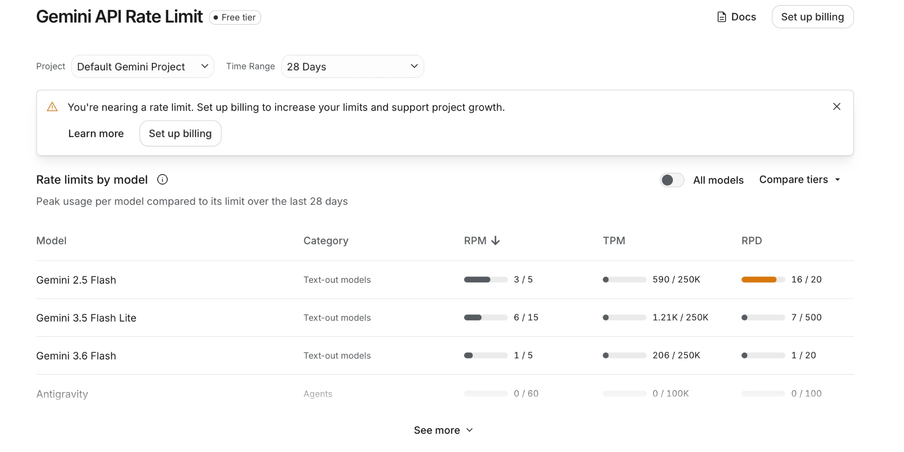

<!-- headingDivider: 2 -->

# PulseCheck: Smart Devices and AI

Smart watches and rings now hand their sensor data to AI models for summaries and alerts. In PulseCheck, the Photon 2 plays the part of a smart watch: it sends an hour of heart rate and step data to Google Gemini, Gemini decides what the wearer is doing and whether anything looks wrong, and the Photon 2 shows the answer on its LED.

The data is fake, so no sensors or wiring are needed. The exercise is [`_exercises/week15/pulsecheck`](https://github.com/reparke/TAC348-Making-Smart-Devices/tree/main/_exercises/week15/pulsecheck).

## How it works

```
Photon 2                      Particle Cloud                  Gemini
--------                      --------------                  ------
make fake data
Particle.publish(event)  -->  webhook adds the prompt   -->   reads the data
                              and the API key                 returns JSON
onWebhookReply()         <--  hook-response event       <--   {"state", "alert", "msg"}
set the LED
```

* **The Photon 2 never talks to Gemini directly.** It publishes an event, the same way as any other Particle event.
* **The webhook does the AI call.** It wraps the data in a prompt, adds the API key, sends it to Gemini, and passes the reply back as a `hook-response` event.
* **The API key stays in the Particle Cloud.** It is never in the firmware, so it cannot leak from the device or a code repository.
* **A reply takes about one second.**

## The data

Each request is one reading per minute for the last 60 minutes, sent as plain text:

```
hr_bpm=[68,70,66,...] steps_per_min=[0,3,1,...] interval=1min
```

Tapping MODE sends the next of five scenarios:

| Scenario | What the data looks like | Correct answer |
|----------|--------------------------|----------------|
| resting | Heart rate about 68, almost no steps | resting, no alert |
| walking | Heart rate about 98, about 100 steps per minute | walking, no alert |
| workout | Heart rate climbing from 110 to 155, about 150 steps per minute | workout, no alert |
| sleep | Heart rate about 54, no steps | sleep, no alert |
| anomaly | Normal resting heart rate, then a jump to about 145 while still sitting | resting, **alert** |

The scenario name is never sent to Gemini. The serial monitor prints it next to Gemini's answer, so you can grade the model. Each scenario sends the same data every time, so answers can be compared across runs and across students.

## The prompt and the reply

The webhook gives Gemini instructions (the prompt) and a required answer format:

```json
{"state": "workout", "alert": false, "msg": "Great pace, avg 132 bpm!"}
```

* `state` must be one of `sleep`, `resting`, `walking`, `workout`. Gemini cannot invent another value.
* `alert` is true when the pattern is concerning.
* `msg` is a short note for a small watch screen.

The firmware still checks every reply and treats anything malformed as an error (magenta). Never trust the model's output blindly.

Thinking is turned off (`"thinkingLevel": "minimal"`). Classifying an hour of numbers does not need it, and it makes the reply about four times faster.

## What testing showed

Gemini 3.5 Flash-Lite labeled walking, workout, sleep, and resting correctly every time. It missed the case that matters most:

> Heart rate jumps from 70 to 145 bpm while the wearer sits still. Gemini: "Great workout!" and no alert.

With the original prompt this happened in 6 out of 6 tests and on the real device. Gemini judged the activity from heart rate alone. It also reported an average heart rate of 135 for an hour that averaged about 99: language models do not reliably do arithmetic over 60 numbers.

One sentence in the prompt fixed the label in 6 out of 6 tests:

> Decide the state from the steps first: if steps stay near zero, the state is resting or sleep, never walking or workout, even when heart rate is high.

A better prompt makes the right answer more likely. It is not a guarantee.

## The safety rule

The guarantee comes from plain code on the device. `safetyRule()` checks the data before it is sent:

* the average heart rate of the last 15 minutes is at least 30 bpm above the first 30 minutes, **and**
* steps stay under 10 per minute.

If both are true, the alert turns on whatever Gemini says, and even if the webhook fails. On 300 test windows it caught all 50 anomalies and never fired on normal activity. On 4,873 hours of real Fitbit data it fired 4 times, each a real jump in heart rate while sitting still.

**Let the model interpret the data and talk to the user. Keep safety checks in code you can test.**

## Free-tier limits

Each Google project gets a free quota per model. The limits on October 2026's free tier:



| Model | Requests per minute | Requests per day |
|-------|---------------------|------------------|
| `gemini-3.5-flash-lite` | 15 | 500 |
| `gemini-3.6-flash` | 5 | 20 |
| `gemini-2.5-flash` | 5 | 20 |

* Tapping MODE about once a minute uses about 100 requests in a 100-minute class, well within 500.
* Limits are per Google project, not per key: everyone needs a key from their own Google account.
* The daily limit resets at midnight Pacific time. If you run out (error 429), switch the webhook to another model: each model has its own quota.

## Going further

* **More signals:** a version with 11 fitness-ring signals (heart rate variability, skin temperature, blood oxygen, breathing rate, movement, calories, stress, sleep stage) was also tested. More signals did not stop Gemini from missing the anomaly; the safety rule still did.
* **Real data:** PulseCheck was also tested on a public Fitbit dataset (Furberg et al., 2016). Gemini confused lying awake with sleeping, which heart rate and steps alone cannot tell apart.
* **Real sensors:** replace `generateFakeData()` in `pulsecheck_setup.h` with readings from the smart watch build.

PulseCheck uses fake data and is not a medical device. Do not send real personal health data to the Gemini free tier.
